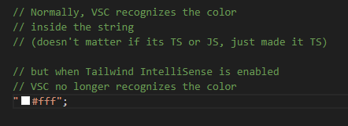
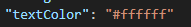

# Tailwind-VSC-No-Colors-Bug
Repo for reproducing a bug with Tailwind CSS that causes VSC to not recognize colors in strings.

I'm not sure why, but the bug only sometimes occurs. May only happen in Next.js (env I was using when it was discovered).

WORKING VSC\
\

THIS HAPPENED IN ANOTHER WINDOW\
